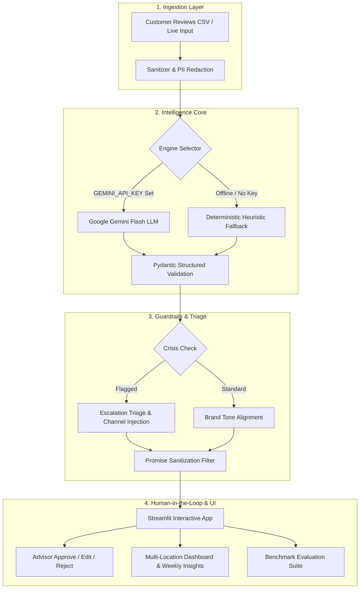

# Revio Copilot

> Enterprise AI customer review intelligence and crisis triage engine with aspect-based sentiment extraction, anti-hallucination guardrails, and deterministic offline fallback.

*Developed for the Cynbit Technologies AI/ML Engineer Assessment (Revio Platform).*

[](https://www.python.org/downloads/)
[](https://streamlit.io)
[](https://docs.pydantic.dev/)
[](https://docs.pytest.org/)
[](LICENSE)

---

## 📌 Overview

**Revio Copilot** is an enterprise AI assistant built for local business chains, hospitality providers, healthcare clinics, and retail stores to monitor customer feedback, intercept operational crises, and draft brand-safe responses. 

Unlike generic sentiment analysis tools that produce superficial star-rating averages, Revio extracts granular, operational root causes across 7 business dimensions, triages dangerous legal and health liabilities, and generates brand-aligned draft replies with strict anti-hallucination guardrails and human-in-the-loop sign-off.

---

## 🚀 Key Features

- **Aspect-Based Sentiment Extraction**: Pinpoints localized customer feedback across 7 key operational dimensions: `service`, `staff`, `price`, `cleanliness`, `delivery`, `quality`, and `ambiance`.
- **Safety-Critical Crisis Triage**: Intercepts acute operational and legal risks (food poisoning, litigation threats, discrimination, billing fraud) with assigned severity tiers (`high`, `medium`, `low`) and recommended escalation paths.
- **Brand Voice Personalization**: Dynamically drafts replies in configurable brand tones (`professional`, `warm`, `concise`).
- **Hard Anti-Hallucination Guardrails**: Regex and semantic filters intercept unauthorized financial commitments (unapproved refunds, compensation promises) or premature liability admissions.
- **Dual-Engine Architecture**:
  - **Primary Engine**: Google Gemini Flash via `google-genai` SDK.
  - **Offline Fallback Engine**: 100% deterministic, zero-dependency heuristic engine executing with zero latency and no external API keys.
- **Multi-Location Operational Dashboard**: Visualizes sentiment distribution, negative complaint hotspots, branch-level comparisons, and weekly executive summaries via Streamlit & Plotly.
- **Automated Model Benchmark**: Built-in evaluation harness scoring Sentiment Accuracy, Macro F1, and Crisis Recall/Precision against a gold-standard dataset.

---

## 🏗️ System Architecture



---

## 🛠️ Tech Stack

| Layer | Technologies |
| :--- | :--- |
| **Language** | Python 3.10+ |
| **UI & Visualization** | Streamlit, Plotly Express, Plotly Graph Objects |
| **Data Validation** | Pydantic v2 (`BaseModel`, `Field`, `validator`) |
| **LLM & AI** | Google GenAI SDK (Gemini Flash) |
| **Data Processing** | Pandas, Scikit-learn |
| **Testing** | Pytest, Pytest-AsyncIO |

---

## 📂 Project Structure

```text
cynbit-revio-copilot/
├── app.py                           # Main Streamlit web application
├── requirements.txt                 # Pinned dependencies
├── README.md                        # Project documentation
├── src/                             # Core intelligence package
│   ├── models.py                    # Pydantic data schemas & validation rules
│   ├── prompts.py                   # System prompt, schema spec, and few-shot exemplars
│   ├── llm_client.py                # Gemini Flash client with retry & timeout logic
│   ├── fallback.py                  # Zero-dependency deterministic offline fallback engine
│   ├── pipeline.py                  # Unified pipeline orchestrator & guardrails
│   ├── insights.py                  # Multi-location analytics & weekly insights generator
│   └── evaluation.py                # Evaluation benchmark harness & scoring metrics
├── data/                            # Datasets & synthetic generation
│   ├── generate_samples.py          # Synthetic review & evaluation set generator script
│   ├── sample_reviews.csv           # 75 multi-location synthetic reviews with edge cases
│   └── labeled_eval_set.csv         # 25 gold-standard labeled reviews for benchmarking
├── tests/                           # Unit and integration test suite
│   ├── test_schemas.py              # Pydantic model validation & boundary tests
│   ├── test_crisis.py               # Crisis detection keyword & regex rule verification
│   ├── test_guardrails.py           # Brand safety & anti-hallucination guardrail tests
│   └── test_fallback.py             # End-to-end offline fallback engine tests
└── docs/                            # Architectural & domain whitepapers
    ├── 01_AI_Opportunity_Report.md  # Strategic business & industry analysis
    └── 02_Technical_Approach_Report.md # Architecture, MLOps, prompts & execution plan
```

---

## ⚙️ Setup and Run Instructions

### 1. Clone the Repository

```bash
git clone https://github.com/Shagunbisht13/cynbit-revio-copilot.git
cd cynbit-revio-copilot
```

### 2. Set Up Virtual Environment

```bash
python -m venv venv
venv\Scripts\activate      # On Windows
source venv/bin/activate   # On macOS/Linux
pip install -r requirements.txt
```

### 3. Run Automated Tests

Execute the 18 automated unit tests:

```bash
pytest
```

*(Expected result: `18 passed in ~0.6s`)*

### 4. Configure API Keys (Optional)

Create a `.env` file in the project root:

```ini
GEMINI_API_KEY=your_gemini_api_key_here
```

*(Note: If no API key is provided, the application automatically switches to its deterministic offline fallback engine with full functionality).*

---

## 💻 Usage

### Launch the Streamlit Application

```bash
streamlit run app.py
```

Navigate to [http://localhost:8501](http://localhost:8501) to interact with:
1. **Live Review Analyzer**: Paste any review to extract aspect sentiments, trigger crisis checks, and generate draft responses.
2. **Batch Processing Workbench**: Ingest CSV datasets for bulk triage with one-click **Approve**, **Edit**, or **Reject** actions.
3. **Multi-Location Analytics**: Branch comparison bar charts and operational trend graphs.
4. **Evaluation Benchmark**: Score the current engine against the 25-review gold standard dataset.

---

## 📸 Screenshots

<!-- Replace placeholders with actual screenshots from your local run -->
| Operational Dashboard & Hotspots | AI Response Composer & Guardrails |
| :---: | :---: |
| ``<br>*(Multi-branch sentiment breakdown & crisis triage alert)* | ``<br>*(Human-in-the-loop response approval & promise filter)* |

---

## ⚠️ Limitations

- **Session-Based Storage**: In this demonstration prototype, advisor approval decisions and edited drafts are stored in Streamlit `session_state` rather than an external SQL database.
- **API Quota Constraints**: When running in online mode with Gemini Flash free tier, high-frequency bulk batch processing may be throttled by Google Cloud rate limits (offline mode is unconstrained).
- **Benchmark Accuracy**: Evaluated on 25-item gold standard set (`data/labeled_eval_set.csv`). [TODO: add benchmark F1 score across full production corpus].

---

## 🔮 Future Improvements

- [ ] Connect webhook dispatchers for automated instant Slack / SMS crisis alerts to branch general managers.
- [ ] Implement multi-lingual review translation for cross-border hospitality brands.
- [ ] Automated weekly executive PDF report generation via WeasyPrint / ReportLab.
