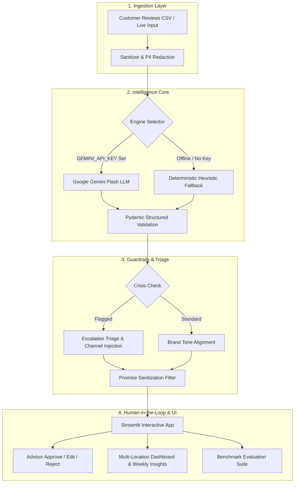

# Revio Review Intelligence Engine 🛡️
### AI Reputation Management, Aspect Sentiment & Crisis Triage Platform
**Cynbit Technologies — AI/ML Engineer Technical Assessment**

[](https://www.python.org/downloads/)
[](https://streamlit.io)
[](https://docs.pydantic.dev/)
[](https://docs.pytest.org/)
[](LICENSE)

---

## 📌 Executive Overview

The **Revio Review Intelligence Engine** is an enterprise-grade AI proof-of-concept designed to upgrade Cynbit’s proprietary **Revio** reputation management platform. 

While generic tools provide superficial star-rating averages or canned responses, Revio extracts granular, operational root causes across business aspects, flags high-liability crisis reviews (e.g., health hazards, litigation threats, discrimination, fraud), and drafts brand-aligned responses with strict anti-hallucination guardrails and human-in-the-loop oversight.

### Key Capabilities
- **Aspect-Based Sentiment Extraction:** Pinpoints localized customer feedback across 7 key operational dimensions: `service`, `staff`, `price`, `cleanliness`, `delivery`, `quality`, and `ambiance`.
- **Safety-Critical Crisis Triage:** Detects acute operational and legal risks with assigned severity tiers (`high`, `medium`, `low`) and immediate recommended mitigation steps.
- **Brand Voice Personalization:** Dynamically generates replies in configurable tones (`professional`, `warm`, `concise`).
- **Hard Anti-Hallucination Guardrails:** Enforces strict prohibitions against unauthorized financial commitments (refunds, discounts, free stays) or liability admissions.
- **Dual-Engine Architecture:** Primary engine powered by Google Gemini Flash; deterministic, zero-dependency offline fallback engine that runs immediately with zero external API requirements.
- **Multi-Location Operational Dashboard:** Aggregate sentiment distribution, negative complaint hotspots, branch-level comparisons, and auto-generated weekly executive insights.
- **Automated Model Benchmark:** Built-in evaluation harness scoring Sentiment Accuracy, Macro F1, and Crisis Recall/Precision against a gold-standard dataset.

---

## 🏗️ System Architecture



---

## 🚀 Setup in Under 5 Steps

### Step 1: Clone the Repository
```bash
git clone https://github.com/your-username/revio-intelligence-engine.git
cd revio-intelligence-engine
```

### Step 2: Create and Activate Virtual Environment
```bash
# macOS/Linux
python3 -m venv venv
source venv/bin/activate

# Windows (PowerShell)
python -m venv venv
.\venv\Scripts\Activate.ps1
```

### Step 3: Install Pinned Dependencies
```bash
pip install -r requirements.txt
```

### Step 4: Configure Environment (Optional)
The application is pre-configured with a deterministic offline engine that runs **100% locally with zero external API keys**.

To enable the primary Google Gemini Flash engine:
```bash
cp .env.example .env
# Edit .env and supply your GEMINI_API_KEY
```
*(If no API key is set, the application automatically defaults to the offline fallback engine without errors).*

### Step 5: Launch the Streamlit Application
```bash
streamlit run app.py
```
Open [http://localhost:8501](http://localhost:8501) in your browser.

---

## 🧪 Running Automated Unit Tests

Execute the comprehensive test suite verifying schemas, crisis rules, guardrails, and offline heuristics:
```bash
pytest -v
```
**Expected Test Results:**
```text
tests/test_crisis.py::test_crisis_health_safety_food_poisoning PASSED
tests/test_crisis.py::test_crisis_legal_threat PASSED
tests/test_crisis.py::test_crisis_discrimination PASSED
tests/test_crisis.py::test_crisis_fraud_scam PASSED
tests/test_crisis.py::test_crisis_viral_reputation PASSED
tests/test_crisis.py::test_non_crisis_standard_complaint PASSED
tests/test_fallback.py::test_sarcasm_detection PASSED
tests/test_fallback.py::test_aspect_extraction_multi PASSED
tests/test_fallback.py::test_offline_analysis_end_to_end PASSED
tests/test_fallback.py::test_brand_tones_generated PASSED
tests/test_guardrails.py::test_guardrail_prevents_unauthorized_refund PASSED
tests/test_guardrails.py::test_guardrail_crisis_includes_escalation_channel PASSED
tests/test_schemas.py::test_aspect_item_valid PASSED
tests/test_schemas.py::test_aspect_item_invalid_sentiment PASSED
tests/test_schemas.py::test_crisis_flag_defaults PASSED
tests/test_schemas.py::test_review_analysis_normalization PASSED
tests/test_schemas.py::test_review_analysis_confidence_bounds PASSED

============================= 17 passed in 0.56s ==============================
```

---

## 📂 Repository Layout

```text
├── .env.example                     # Environment template for GEMINI_API_KEY
├── .gitignore                       # Standard Python / Streamlit / secret ignores
├── requirements.txt                 # Pinned dependencies
├── README.md                        # Project documentation & instructions
├── app.py                           # Streamlit application entry point
├── src/
│   ├── __init__.py
│   ├── models.py                    # Pydantic data schemas & validation rules
│   ├── prompts.py                   # System prompt, schema spec, and few-shot exemplars
│   ├── llm_client.py                # Gemini Flash client with retry & timeout logic
│   ├── fallback.py                  # Zero-dependency deterministic offline fallback engine
│   ├── pipeline.py                  # Unified pipeline orchestrator & guardrails
│   ├── insights.py                  # Multi-location analytics & weekly insights generator
│   └── evaluation.py                # Evaluation benchmark harness & scoring metrics
├── data/
│   ├── generate_samples.py          # Synthetic review & evaluation set generator script
│   ├── sample_reviews.csv           # 75 multi-location synthetic reviews with edge cases
│   └── labeled_eval_set.csv         # 25 gold-standard labeled reviews for benchmarking
├── tests/
│   ├── __init__.py
│   ├── test_schemas.py              # Pydantic model validation & boundary tests
│   ├── test_crisis.py               # Crisis detection keyword & regex rule verification
│   ├── test_guardrails.py           # Brand safety & anti-hallucination guardrail tests
│   └── test_fallback.py             # End-to-end offline fallback engine tests
└── docs/
    ├── 01_AI_Opportunity_Report.md  # Strategic business & industry analysis (3-4 pages)
    └── 02_Technical_Approach_Report.md # Architecture, MLOps, prompts & execution plan (3-5 pages)
```

---

## 📊 Using Custom or Public Datasets

The application includes a pre-packaged synthetic dataset (`data/sample_reviews.csv`) covering 75 realistic reviews across 4 branch locations and 3 SMB industries (Hospitality, Healthcare, Retail).

### Using Public Datasets (e.g., Yelp, Amazon, Google Reviews)
To test with public datasets:
1. Obtain a public review CSV (e.g. from the [Yelp Open Dataset](https://www.yelp.com/dataset) or [Amazon Customer Reviews](https://registry.opendata.aws/amazon-reviews/)).
2. Ensure your CSV contains at least a column named `review_text` (optional columns: `rating`, `location`, `date`).
3. Select **"Upload Custom CSV"** in the Streamlit sidebar and upload your file. The engine will parse and analyze it immediately.

---

## 🛡️ Brand Guardrails & Human-in-the-Loop Protocol

1. **No-Promise Guardrail:** Automated regex and semantic filters intercept phrases offering unauthorized refunds, free services, or liability admissions.
2. **Mandatory Human-in-the-Loop:** Automated drafts require frontline advisor review. The UI provides one-click **Approve**, **Edit**, or **Reject** actions that update local session state.
3. **Private Crisis Escalation:** High-severity crisis reviews automatically append a direct leadership escalation link (`escalations@cynbit-client.com`), removing sensitive disputes from public visibility.

---

## ⚠️ Known Limitations & Scope Boundaries

- **Local State in PoC:** Approval states and edited responses are maintained within the active Streamlit session rather than written to an external database.
- **Multilingual Support:** The primary LLM natively understands Hindi and Hinglish; however, the offline fallback heuristic engine is optimized for English with transliterated keyword support.
- **No Direct API Publishing:** Out of abundance of caution and compliance with Google/TripAdvisor terms, the PoC does not auto-publish responses to third-party APIs without manual human confirmation.

---

## 📄 License & Attribution
Developed for the **Cynbit Technologies** AI/ML Engineer assessment.  
Confidential submission.
